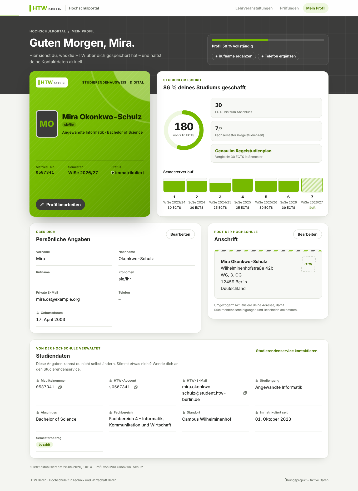

# HTW Berlin · Profilverwaltung für Studierende

Profilseite für das (fiktive) Hochschulportal der HTW Berlin. Studierende sehen ihre persönlichen Angaben und Studiendaten und können Name, Kontakt und Anschrift bearbeiten – kritische IDs (Matrikelnummer, HTW-Account, Studiendaten, Geburtsdatum) sind gesperrt.

**Stack:** Vue 3 (Composition API, `<script setup>`) · TypeScript (strict) · Vite · reines CSS
**Übungsprojekt** – es gibt noch kein Backend; Daten kommen aus einem Mock-Repository (localStorage).



## Schnellstart

Voraussetzung: **Node.js ≥ 20.19** (getestet mit Node 22) und npm.

```bash
npm install          # Abhängigkeiten installieren
npm run dev          # Entwicklungsserver → http://localhost:5173
```

| Befehl | Zweck |
|---|---|
| `npm run dev` | Dev-Server mit Hot Reload (Port 5173) |
| `npm run build` | Typprüfung (`vue-tsc`) + Produktionsbuild nach `dist/` |
| `npm run preview` | Produktionsbuild lokal ausliefern (Port 4173) |
| `npm run typecheck` | Nur Typprüfung |
| `npm test` | Unit-Tests (Vitest) einmalig ausführen |
| `npm run test:watch` | Tests im Watch-Modus |

### Demo-Schalter (URL-Parameter)

| Parameter | Wirkung | Beispiel |
|---|---|---|
| `latenz` | simulierte Serverlatenz in ms (Standard 450) | `/?latenz=0` |
| `fehlerquote` | Wahrscheinlichkeit 0–1 für simulierte Netzwerkfehler | `/?fehlerquote=0.5` |

**Konflikt ausprobieren:** Seite in zwei Tabs öffnen, in Tab A speichern, danach in Tab B speichern → Konfliktdialog.
**Zurücksetzen:** im Browser `localStorage.removeItem('htw.portal.profile.v1')` ausführen.

## Funktionen

- **Profilansicht** mit digitalem Studierendenausweis, Begrüßung und Profil-Vollständigkeit
- **Persönliche Angaben** und **Anschrift** anzeigen und bearbeiten (Vor-/Nachname, Rufname, Pronomen, private E-Mail, Telefon, Adresse)
- **Studiendaten** einsehen (gesperrt, mit Kopieren-Funktion für IDs)
- **Studienfortschritt:** ECTS-Ring, Vergleich mit dem Regelstudienplan, Semesterverlauf
- **Bearbeiten-Sheet:** Live-Validierung, Änderungsvorschau (bisher → neu), Strg/Cmd+S, Schutz vor Datenverlust
- **Kontextsensitiv:** „+ Telefon ergänzen“ öffnet den Editor direkt im richtigen Feld
- **Robust:** Versionskonflikte, Netzwerkfehler und Server-Validierung werden verständlich behandelt
- **Barrierefrei & modern:** Tastaturbedienung, ARIA, AA-Kontraste, Dark Mode, Reduced Motion, responsiv bis 320 px

## Architektur

UI, Zustand und Fachlogik sind getrennt:

```
domain/      Fachlogik (Typen, Feld-Whitelist, Validierung, Insights) – framework-frei, getestet
services/    Datenzugriff hinter StudentRepository-Interface (aktuell Mock)
stores/      Anwendungszustand (Factory + provide/inject)
composables/ UI-nahe Logik (Formular, Toasts, Shortcuts)
components/  Darstellung (ui/ = generisch, profile/ = fachlich)
views/       Orchestrierung
```

Anbindung eines echten Backends: `HttpStudentRepository implements StudentRepository` schreiben und in `src/main.ts` statt des Mocks übergeben – keine UI-Änderung nötig.

## Projektablauf & Dokumentation

1. [Architekturentwurf](docs/ARCHITECTURE.md) → [Peer-Review durch Senior Software Architect](docs/ARCHITECTURE-REVIEW.md) (Approve with changes, alle Punkte umgesetzt)
2. Implementierung aller Funktionen inkl. Tests
3. [UI/UX-Review & neues Designkonzept „Campus-Ausweis“](docs/UX-REVIEW.md) in HTW-CI

## Hinweise zur CI

- Farben: HTW-Grün `#76B900`, Anthrazit `#3C3C3B`, Orange `#FF5F00` (in `src/styles/tokens.css`). Abgedunkelte Stufen nur für Textkontraste.
- **Logo:** `src/components/ui/BrandLogo.vue` enthält einen Nachbau der Wortmarke. Die offizielle Logodatei konnte in der Entwicklungsumgebung nicht bezogen werden – vor einem Einsatz bitte durch die Originalpfade aus dem CD-Portal der HTW ersetzen und die Farbwerte gegen das CD-Manual prüfen.
